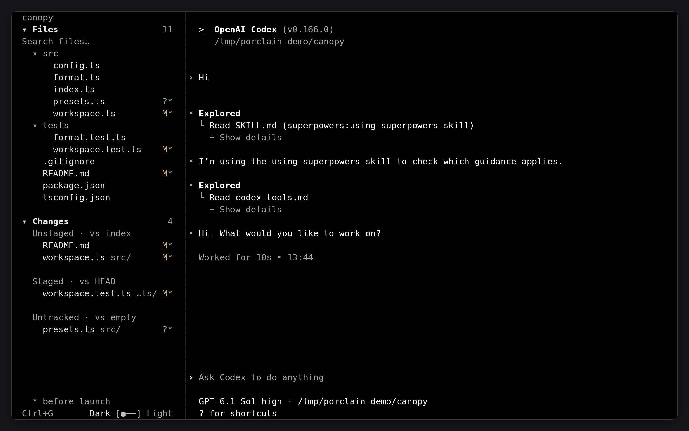
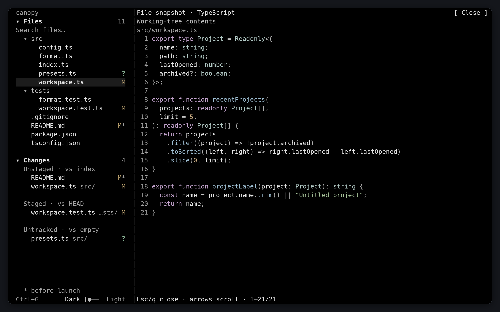
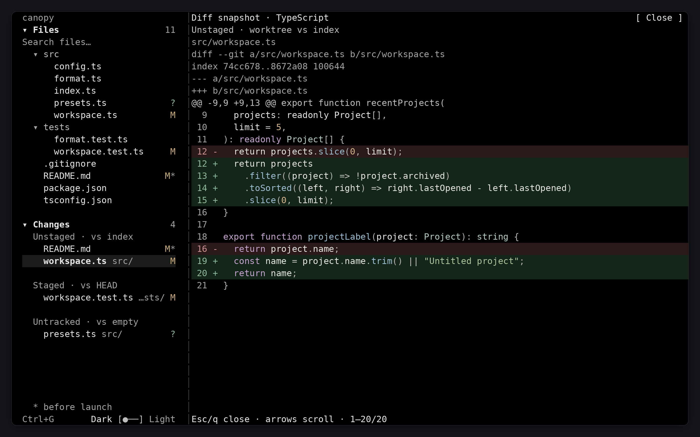
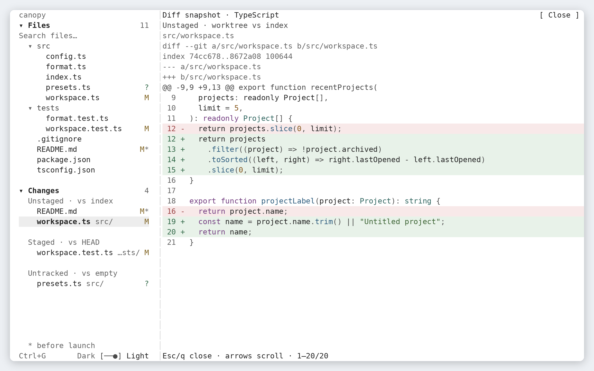

# PorclainTree

Your CLI, with a read-only file explorer and live Git changes alongside it.



<details>
<summary>File and diff previews</summary>

**File preview · Dark**



**Diff preview · Dark**



**Diff preview · Light**



</details>

## Quick start

Requires **Linux**, [Bun](https://bun.com/docs/installation) **1.3.14+**, Git, and an interactive terminal. Install the CLI you want to run separately.

```sh
git clone https://github.com/dariokl/porclain-tree.git
cd porclain-tree
bun install --frozen-lockfile
bun start -- codex
```

Replace `codex` with your command and its arguments, for example `bun start -- bash`.

To explore another Git repository, launch from that repository:

```sh
cd /path/to/your/project
bun run /path/to/porclain-tree/src/cli.ts -- codex
```

Your command keeps its working directory and exit behavior.

## Controls

| Control | Action |
| --- | --- |
| **Ctrl+G** | Toggle the sidebar. |
| Click **Files** or **Changes** | Collapse or expand the section. |
| Click a folder | Expand or collapse it. |
| Click a file or change | Open a read-only snapshot. |
| Click **Search files** | Filter filenames and paths. **Enter** opens the first visible match; **Esc** clears search and returns typing to the CLI. |
| Mouse wheel | Scroll the section or preview under the pointer. |
| Arrows in a preview | Scroll vertically or horizontally. |
| **Page Up/Down**, **Home/End** | Navigate an open preview. |
| **Esc**, **q**, or **Close** | Close a preview and return to the CLI. |
| **Ctrl+C** | Reach the CLI, including during search and previews. |
| Click **Dark/Light** | Change the sidebar and preview theme. |

Press **Ctrl+G twice within 300 ms** to restore the previous sidebar state and send one literal Ctrl+G to the CLI. Search and previews capture typing and paste. The theme switch leaves the CLI's colors unchanged.

## Exploring your project

**Files** lists tracked and non-ignored untracked files. Search matches filenames and paths without regard to case, including inside collapsed folders.

**Changes** groups unstaged, staged, untracked, and conflicted paths. A `*` marks paths dirty at launch; Git changes do not identify which agent or session made an edit. Lists refresh about once per second and retain a stale snapshot on errors.

**Previews** show numbered file snapshots or labeled Git comparisons:

| Diff | Baseline |
| --- | --- |
| Staged | Index vs HEAD |
| Unstaged | Working tree vs index |
| Untracked | File vs empty content |
| Conflict | Combined conflict diff |

JavaScript/JSX, TypeScript/TSX, and Python receive syntax highlighting; other files use plain text. Parsers are local, with no Python installation or runtime downloads needed. Diffs preserve metadata and hunk labels, with colored additions and deletions. Conflicts, summaries, and incomplete patches retain the raw view.

Select an entry again to reload its snapshot. Tabs appear as four spaces, control characters are escaped, and long lines scroll horizontally.

Dark is the default. To start in light mode:

```sh
PORCLAINTREE_THEME=light bun start -- codex
```

## Limitations

- **Linux only.** File checks and process cleanup use `/proc`; macOS and Windows support is not implemented or verified.
- The sidebar collapses below **100 terminal columns** and restores your selected visibility when widened.
- File listing is limited to **10,000 paths**. Reads are bounded to **2 seconds, 1 MiB, and 10,000 lines**.
- Text previews require UTF-8 regular files. Binary files show an explanation or Git's diff summary; symlinks and non-regular files cannot be previewed as text.
- Deleted paths, empty directories, and submodule contents are omitted from Files. Untracked directory summaries cannot expand; renames into or out of their former directory path require direct Git inspection.
- Commands that deliberately detach into their own session are outside the wrapper's cleanup scope.

## Development

Built with TypeScript, Bun, and OpenTUI.

```sh
bun run typecheck
bun test
```

## License

Licensed under the [MIT License](LICENSE).
